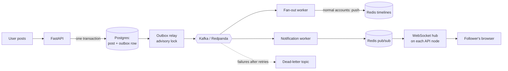
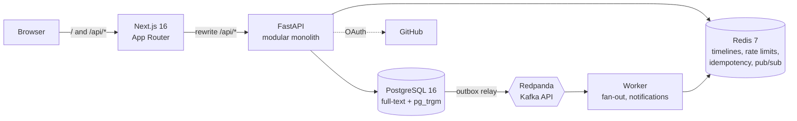

# Nexora

A Twitter-style social platform, built to show the systems behind the feed and not only the UI on top of it.

<p>
  
  
  
  
</p>


Posts, replies, reposts, likes, follows, search, a home timeline, notifications and direct
messages. The interesting part is the backend: feeds that stay fast when one account has thousands
of followers, events that are not lost when the message broker goes down, and messages that reach
a user connected to a different server. Everything runs on a laptop with Docker, no cloud account
and no cost.

## Screenshots

Taken from the running app with the seed data (10,000 users, ~190,000 posts).

| Thread with replies | Search (phrases, OR, -exclude) | Profile with 8.4K followers |
| --- | --- | --- |
|  |  |  |

### Next up: notifications and messages UI

The backend for both is written (see status below). These two screens are design previews of the UI
still to build, drawn inside the real app with its own styles. They are not screenshots of working
features yet.

| Notifications (preview) | Direct messages (preview) |
| --- | --- |
|  |  |

## Results so far

Measured on a laptop (Windows 11, 7.9 GB RAM, Docker Desktop) with 10,000 seeded users and
191,876 posts. Reproduce with `python -m nexora.cli.bench`.

| What | Before | After |
| --- | --- | --- |
| Worst-case home-timeline query | 40 ms | 1.7 ms |
| Publishing a celebrity post (push to all followers vs. merged at read time) | 213 ms (p95 303 ms) | 2 ms |
| Heavy-viewer timeline SQL | 9.7 ms | 4.4 ms |
| Friend's new post reaching a follower's Redis timeline | n/a | 140 ms |

Every number here comes from a real run. Load-test results (k6) will be added when they exist.

## Status and where it's going

The end goal is a social platform that runs on a local Kubernetes cluster, survives a broker or
node being killed mid-traffic, and has published load-test numbers for every optimisation.

| Area | State |
| --- | --- |
| Auth (password + GitHub), profiles, follow graph | Done, tested |
| Posts, replies, reposts, likes, hashtags, mentions, search, who-to-follow | Done, tested |
| Home timeline with a query plan picked per viewer | Done, tested |
| Transactional outbox, Kafka relay, retries, dead-letter topic | Done, tested |
| Hybrid fan-out timeline in Redis (push for normal users, pull for celebrities) | Done, tested |
| Notifications service (idempotent consumer, live push channel) | Done, tested |
| Direct messages + WebSocket hub (sequence numbers, receipts, presence) | Code written, tests in progress |
| Notifications and messages UI, image uploads to MinIO | Next |
| Kubernetes (k3d) with Terraform and Helm, rolling deploys with zero failed requests | Planned |
| OpenTelemetry, Prometheus, Grafana; k6 load tests; chaos tests | Planned |

Full plan: [docs/ROADMAP.md](docs/ROADMAP.md). Design decisions: [docs/adr](docs/adr/README.md).

## How a post travels



Celebrity posts are not pushed to millions of timelines. They are merged in when a follower reads
their feed. The event pipeline has at-least-once delivery, so every consumer is idempotent.

## What's interesting here

Each item links to the decision record explaining the trade-off.

| Problem | What Nexora does |
| --- | --- |
| Ids that sort by time and never collide across servers | 64-bit Snowflake ids minted in-process, sent to clients as strings ([ADR 0002](docs/adr/0002-snowflake-ids.md)) |
| Stolen refresh tokens | 15-minute JWTs + rotating refresh tokens; replaying an old one revokes the whole session family ([ADR 0003](docs/adr/0003-auth-rotating-refresh-tokens.md)) |
| Two browser tabs refreshing at once | Web Locks serialise refresh across tabs, so rotation never looks like theft ([`apps/web/src/lib/api.ts`](apps/web/src/lib/api.ts)) |
| Paging through 8,000+ followers | Keyset cursors: constant cost per page, stable while new rows arrive ([ADR 0004](docs/adr/0004-keyset-pagination.md)) |
| A timeline query that's fast for heavy users reads the whole table for light ones | Measured both plans; the home timeline picks per viewer. Worst case went from 40 ms to 1.7 ms ([ADR 0007](docs/adr/0007-home-timeline-fan-out-on-read.md)) |
| A page of 20 posts quietly running 100 queries | Hydration is at most 5 queries per page, whatever its size; a test counts the SQL |
| Double-taps, retries, concurrent likes and reposts | Idempotent writes on composite keys; counters only move when a row actually changes |
| A client retrying "Post" after a timeout | `Idempotency-Key` header: the retry returns the first post instead of a duplicate |
| Deleting a post that has replies | Tombstones keep the thread intact without revealing deleted text ([ADR 0008](docs/adr/0008-post-tombstones.md)) |
| Concurrent repost and delete leaving a repost of nothing | One lock order everywhere (original first), so neither orphans nor deadlocks |
| Search without running Elasticsearch | Postgres full-text (`websearch_to_tsquery`: phrases, OR, -exclusions) + `pg_trgm` for people ([ADR 0009](docs/adr/0009-postgres-search.md)) |
| "Sign in with GitHub" as an account-takeover vector | Matched on GitHub's user id only, never by email; `state` bound to the browser against login CSRF ([ADR 0011](docs/adr/0011-github-oauth-no-email-linking.md)) |
| A follows B while B follows A | Counter rows locked in id order, so mutual follows can't deadlock (tested) ([ADR 0006](docs/adr/0006-denormalised-counters.md)) |
| Login timing leaks which usernames exist | Unknown users still pay for an Argon2 verify |
| Credential stuffing and spam | Redis rate limits per IP *and* per account on login; 30 posts/min per user |
| Test data that hides real problems | Power-law seed: median user has 12 followers, top account has 84% of all users, and posts, likes, replies and reposts follow the same skew |

Every error has the same shape and tells the caller what to do next:

```json
{
  "error": {
    "code": "token_expired",
    "message": "Access token has expired.",
    "hint": "Call POST /api/v1/auth/refresh to get a new access token.",
    "request_id": "05f067fd58a44a609879776ad240ea9d"
  }
}
```

The `request_id` is also on the `X-Request-ID` header and in the server's JSON log line, so a bug
report maps straight to a log entry.

## Run it locally

Needs Docker Desktop and Node.js 22+. Works on Windows, macOS and Linux, and costs nothing.

```bash
# 1. Postgres, Redis and the API (migrations run automatically)
docker compose up -d

# 2. Seed 10,000 users, ~400,000 follows, ~190,000 posts and ~240,000 likes (about 80 seconds)
docker compose run --rm api python -m nexora.cli.seed --reset

# 3. The web app
cd apps/web
npm install
npm run dev
```

Open http://localhost:3000 and log in as **`demo` / `nexora-demo`**. Every seeded account uses
that password; try `celeb_1` for the most-followed account.

Interactive API docs: http://localhost:8000/docs

> Port already in use? Set `POSTGRES_PORT`, `REDIS_PORT`, `API_PORT` or `WEB_PORT` before
> `docker compose up`, e.g. `POSTGRES_PORT=5433 docker compose up -d`.

To run the whole stack in containers, including a production build of the web app:

```bash
docker compose --profile web up -d --build
```

GitHub sign-in is optional and off by default; [apps/api/README.md](apps/api/README.md#github-sign-in)
shows how to turn it on with a free GitHub OAuth app.

## Tests and benchmarks

```bash
docker compose run --rm api pytest              # API tests against real Postgres, Redis and Kafka
docker compose run --rm api ruff check src tests migrations
cd apps/web && npx tsc --noEmit && npm run lint && npm run build

# Home-timeline latency on the seed data (the Phase 2 baseline)
docker compose run --rm api python -m nexora.cli.bench --compare
```

The API suite migrates its own `nexora_test` database down and up on every run, so broken
downgrades fail CI too. CI runs all of the above plus both production Docker builds on every push.

## Architecture



The browser only ever talks to the Next.js origin; `/api/*` is proxied to FastAPI. That keeps the
refresh cookie first-party and removes CORS from the picture.

The API is a modular monolith ([ADR 0001](docs/adr/0001-modular-monolith.md)): one deployable,
with domains that talk through each other's service functions.

```
apps/api/src/nexora/
  core/          config, ids, db, errors, security, rate limiting, idempotency, logging, realtime
  events/        transactional outbox, Kafka relay, consumers, dead-letter topic
  modules/
    auth/        register, login, refresh rotation, logout, GitHub OAuth
    users/       profiles
    social/      follow graph, follower/following lists, who to follow
    posts/       posts, replies, reposts, likes, hashtags, mentions, threads
    feed/        home timeline, profile tabs, hashtag feeds
    search/      full-text post search, people search
    notifications/  idempotent consumer, live push channel
    messaging/   conversations, WebSocket hub, receipts, presence
    health/      liveness and readiness probes
  cli/seed.py    power-law graph and activity generator
  cli/bench.py   home-timeline latency benchmark
apps/web/src/
  lib/           API client, auth context
  components/    post card, composer, feeds, follow button, who to follow
  app/           pages: home, thread, profile, hashtag, search, login, register, settings
```

## Stack

FastAPI · SQLAlchemy 2 (async) · Alembic · PostgreSQL 16 · Redis 7 · Argon2id · PyJWT · HTTPX ·
Next.js 16 · React 19 · Tailwind CSS 4 · TypeScript · Docker Compose · GitHub Actions

Also in the code: Redpanda (Kafka API), aiokafka, WebSockets.
Planned: MinIO, Kubernetes (k3d), Terraform, Helm, OpenTelemetry, Prometheus, Grafana, k6.

## Hosting cost: $0, no cloud account

Everything, including the Phase 4 Kubernetes cluster, runs on a laptop: Docker Compose for
development and load tests, k3d provisioned by Terraform for the production-style setup, MinIO for
S3-compatible storage. No card, no free-tier sign-ups, nothing to forget to shut down. See
[ADR 0010](docs/adr/0010-local-production-infrastructure.md).
